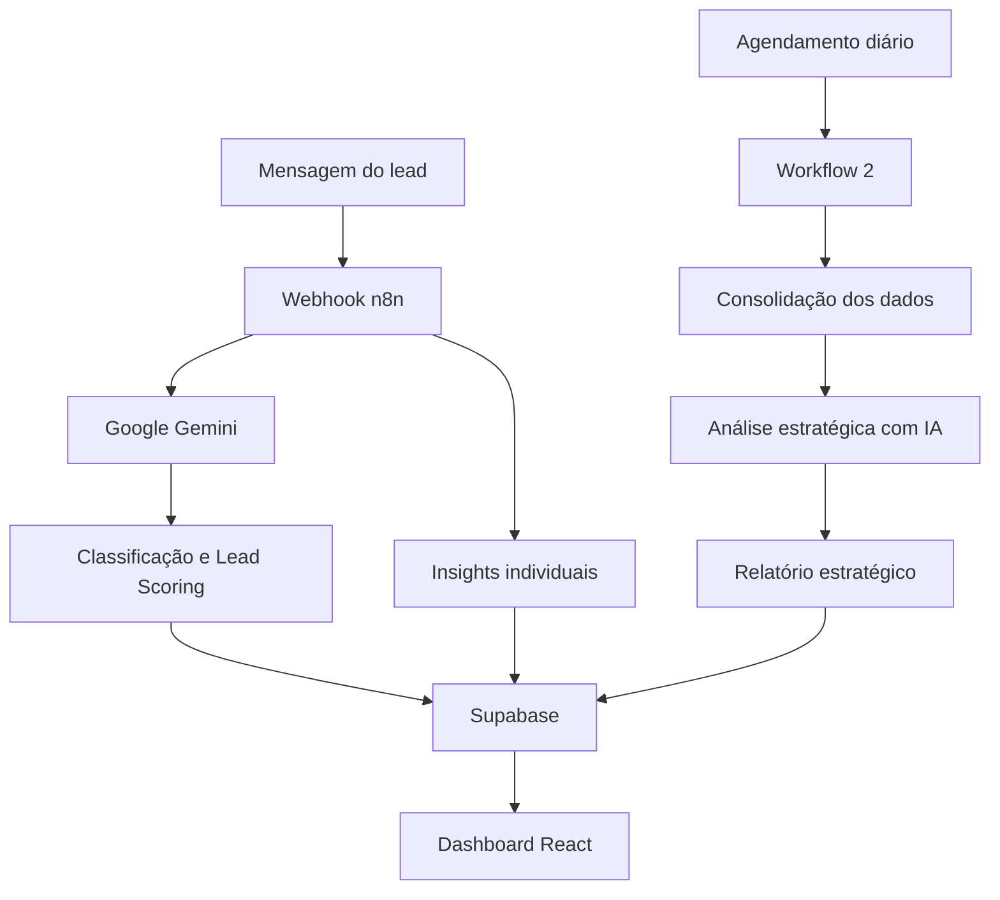

# Sales Intelligence AI — Documentação Técnica

## 1. Visão geral

O **Sales Intelligence AI** é uma aplicação de inteligência comercial que utiliza automação e inteligência artificial para analisar mensagens de potenciais clientes, classificar leads, gerar insights e consolidar informações em relatórios estratégicos.

O projeto simula uma solução B2B para apoiar equipes comerciais na organização, qualificação e priorização de oportunidades.

A aplicação integra workflows automatizados, processamento com IA, banco de dados e um dashboard interativo.

### Links do projeto

- **Aplicação:** https://sales-intelligence-ai-seven.vercel.app/
- **Repositório:** https://github.com/joaopreiss/sales-intelligence-ai

## 2. Arquitetura da solução

O sistema é dividido em quatro componentes principais:

- **Frontend:** interface desenvolvida com React, responsável pela visualização dos dados.
- **Automação:** workflows no n8n para processamento individual e análise estratégica.
- **Inteligência artificial:** Google Gemini para interpretação de mensagens e geração de análises.
- **Banco de dados:** Supabase para persistência e atualização dos dados.

### Fluxo geral



## 3. Workflows de automação

### Workflow 1 — Sales Intelligence

Responsável pelo processamento individual dos leads.

Etapas:

1. Recebimento de uma mensagem por webhook.
2. Envio do conteúdo para análise pelo Google Gemini.
3. Identificação da categoria e necessidade do lead.
4. Definição da prioridade e do lead score.
5. Classificação da temperatura comercial.
6. Identificação da necessidade de atendimento humano.
7. Geração de insights e próximos passos recomendados.
8. Armazenamento das informações no Supabase.

Principais campos produzidos:

- `categoria`
- `necessidade`
- `prioridade`
- `lead_score`
- `classificacao_lead`
- `precisa_de_humano`
- `proximo_passo`

### Workflow 2 — Análise Estratégica

Responsável pela consolidação dos dados comerciais e geração de relatórios.

O workflow possui execução programada diariamente às 18h.

Etapas:

1. Consulta dos dados comerciais disponíveis.
2. Consolidação das informações dos leads.
3. Envio dos dados para análise pela IA.
4. Identificação de padrões e oportunidades.
5. Geração de um relatório estratégico.
6. Armazenamento do relatório no Supabase.

## 4. Tecnologias utilizadas

| Tecnologia | Aplicação |
|---|---|
| React | Construção da interface |
| JavaScript | Lógica da aplicação |
| Vite | Ambiente de desenvolvimento e build |
| Tailwind CSS | Estilização |
| React Router | Navegação entre páginas |
| Recharts | Visualização de dados |
| Lucide React | Biblioteca de ícones |
| n8n | Orquestração dos workflows |
| Google Gemini | Análise e geração de insights |
| Supabase | Banco de dados e Realtime |
| Git e GitHub | Versionamento |
| Vercel | Hospedagem do frontend |

## 5. Banco de dados

O Supabase é utilizado para persistir as informações processadas pelos workflows.

### Tabela `leads`

Armazena os dados dos leads e suas classificações comerciais.

### Tabela `insights_leads`

Armazena os diagnósticos, oportunidades e recomendações gerados pela IA para cada lead.

### Tabela `relatorios_estrategicos`

Armazena os relatórios consolidados produzidos pelo segundo workflow.

### Atualização em tempo real

A aplicação utiliza Supabase Realtime para acompanhar alterações nos dados e atualizar a interface sem depender de recarregamentos manuais.

## 6. Interface do sistema

O dashboard foi desenvolvido com uma identidade visual escura, inspirada em ferramentas de monitoramento e análise de dados.

O sistema possui cinco áreas principais:

- **Dashboard:** visão geral dos indicadores comerciais.
- **Leads:** visualização e acompanhamento dos contatos.
- **Inteligência:** insights e análises gerados pela IA.
- **Desempenho:** acompanhamento de métricas comerciais.
- **Oportunidades:** identificação de leads com maior potencial comercial.

## 7. Configuração local

### Pré-requisitos

- Node.js
- npm
- Projeto Supabase configurado

### Instalação

Clone o repositório:

```bash
git clone https://github.com/joaopreiss/sales-intelligence-ai.git
```

Entre na pasta:

```bash
cd sales-intelligence-ai
```

Instale as dependências:

```bash
npm install
```

### Variáveis de ambiente

Crie um arquivo `.env` na raiz do projeto:

```env
VITE_SUPABASE_URL=sua_url_supabase
VITE_SUPABASE_PUBLISHABLE_KEY=sua_chave_publica
```

Utilize as credenciais públicas apropriadas do projeto Supabase. Nunca coloque chaves privilegiadas no frontend.

### Executar localmente

```bash
npm run dev
```

### Gerar build de produção

```bash
npm run build
```

### Visualizar a build

```bash
npm run preview
```

## 8. Segurança

O projeto utiliza variáveis de ambiente para configurar a conexão com o Supabase.

As principais medidas adotadas incluem:

- Arquivos `.env` excluídos do versionamento.
- Utilização de chave pública apropriada no frontend.
- Row Level Security (RLS) habilitado nas tabelas.
- Políticas de acesso configuradas no Supabase.
- Credenciais privilegiadas mantidas fora do frontend.

**Observação:** os dados utilizados na demonstração são fictícios. As políticas de leitura pública são destinadas ao ambiente demonstrativo e devem ser revistas antes de utilizar dados comerciais reais.

## 9. Status do projeto

O projeto possui:

- Dashboard publicado na Vercel.
- Integração com Supabase.
- Atualização de dados em tempo real.
- Workflow de processamento individual de leads.
- Workflow de análise estratégica programada.
- Geração e armazenamento de relatórios estratégicos.

A entrada de leads é realizada por webhook. A integração com WhatsApp não faz parte do fluxo operacional atualmente publicado.

## 10. Objetivo do projeto

O Sales Intelligence AI foi desenvolvido como projeto de portfólio para explorar a aplicação prática de inteligência artificial, automação e análise de dados em processos comerciais.

O objetivo é demonstrar como essas tecnologias podem transformar mensagens não estruturadas em informações organizadas, apoiar a qualificação de leads e fornecer informações estratégicas para a tomada de decisões.

---

Desenvolvido como projeto de portfólio com foco em IA aplicada a negócios, automação e inteligência comercial.