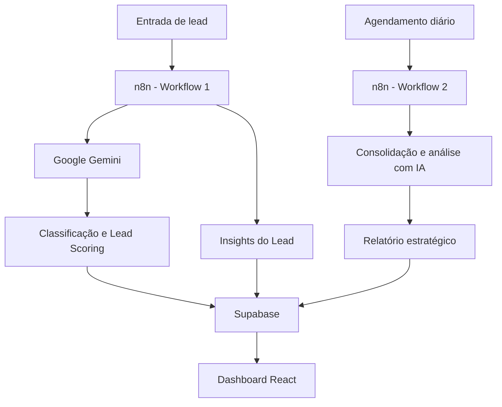

# Sales Intelligence AI

Plataforma de inteligência comercial que utiliza automação e inteligência artificial para analisar leads, identificar oportunidades de negócio e transformar dados comerciais em insights estratégicos.

O projeto combina workflows de automação, análise com IA, persistência de dados e um dashboard interativo para centralizar informações e apoiar decisões comerciais.

**[Acessar demonstração](https://sales-intelligence-ai-seven.vercel.app/)** · **[Repositório GitHub](https://github.com/joaopreiss/sales-intelligence-ai)**

## Sobre o projeto

O Sales Intelligence AI foi desenvolvido para simular uma solução de inteligência comercial, automatizando parte do processo de análise e qualificação de leads.

A proposta é transformar mensagens recebidas em informações estruturadas, permitindo identificar o perfil, a prioridade, o potencial comercial e as próximas ações recomendadas para cada lead.

Além da análise individual, o sistema possui um workflow de análise estratégica que consolida os dados e gera relatórios sobre o cenário comercial.

## Funcionalidades

- **Análise automatizada de leads:** interpretação de mensagens recebidas utilizando IA.
- **Lead Scoring:** pontuação para avaliar o potencial comercial de cada lead.
- **Classificação de leads:** categorização por temperatura comercial.
- **Identificação de prioridades:** classificação da urgência e necessidade do lead.
- **Insights comerciais:** geração de informações para apoiar decisões e abordagens de vendas.
- **Próximas ações recomendadas:** sugestões de encaminhamento para cada lead.
- **Dashboard interativo:** visualização centralizada de indicadores e dados comerciais.
- **Relatórios estratégicos:** análise consolidada e automatizada do cenário comercial.
- **Atualização em tempo real:** integração com Supabase Realtime para atualização das informações na interface.

## Dashboard

A interface foi desenvolvida com foco na visualização de informações, acompanhamento de indicadores e análise comercial.

Principais áreas:

- **Dashboard:** visão geral do cenário comercial e indicadores.
- **Leads:** visualização e acompanhamento dos leads recebidos.
- **Inteligência:** insights e análises gerados pela IA.
- **Desempenho:** acompanhamento de métricas e resultados.
- **Oportunidades:** visualização de oportunidades comerciais identificadas.

## Arquitetura

O projeto utiliza uma arquitetura integrada entre interface, automação, inteligência artificial e banco de dados.





### Fluxo de processamento

**1. Recebimento**

O sistema recebe uma mensagem de lead por meio de um webhook, que inicia o fluxo de automação.

**2. Análise com IA**

O Gemini analisa o conteúdo e extrai informações estruturadas, como:

- Categoria
- Necessidade
- Prioridade
- Lead Score
- Classificação do lead
- Necessidade de atendimento humano
- Próximo passo recomendado

**3. Persistência**

Os dados processados são armazenados no Supabase, permitindo que a interface consulte e acompanhe os resultados.

**4. Visualização**

O dashboard apresenta os leads, indicadores, insights e informações estratégicas.

**5. Análise estratégica**

Um segundo workflow executa diariamente uma análise consolidada dos dados comerciais, gerando relatórios estratégicos armazenados no banco de dados.

## Workflows de automação

### Workflow 1 — Sales Intelligence

Responsável pelo processamento individual dos leads.

- Recebimento de dados via webhook.
- Análise da mensagem utilizando Gemini.
- Classificação e pontuação do lead.
- Geração de insights e recomendações.
- Armazenamento das informações no Supabase.

### Workflow 2 — Análise Estratégica

Responsável pela análise consolidada do cenário comercial.

- Execução programada diariamente às 18h.
- Consolidação dos dados de leads.
- Análise de indicadores e padrões.
- Identificação de oportunidades.
- Geração de relatório estratégico.
- Persistência do relatório no Supabase.

## Tecnologias utilizadas

| Tecnologia | Aplicação |
|---|---|
| React | Construção da interface |
| JavaScript | Lógica da aplicação |
| Vite | Ambiente de desenvolvimento e build |
| Tailwind CSS | Estilização |
| React Router | Navegação entre páginas |
| Recharts | Visualização de dados e gráficos |
| Lucide React | Biblioteca de ícones |
| Supabase | Banco de dados e Realtime |
| @supabase/supabase-js | Integração do frontend com Supabase |
| n8n | Orquestração e automação dos workflows |
| Google Gemini | Análise de leads e geração de insights |
| Git / GitHub | Versionamento e gerenciamento do código |
| Vercel | Hospedagem do frontend |

## Estrutura de dados

O sistema utiliza tabelas no Supabase para organizar os dados:

- `leads` — informações e classificações dos leads.
- `insights_leads` — análises e insights individuais.
- `relatorios_estrategicos` — relatórios de análise comercial consolidada.

## Executando localmente

### Pré-requisitos

- Node.js
- npm
- Projeto Supabase configurado

### 1. Clone o repositório

```bash
git clone https://github.com/joaopreiss/sales-intelligence-ai.git
```

### 2. Entre na pasta do projeto

```bash
cd sales-intelligence-ai
```

### 3. Instale as dependências

```bash
npm install
```

### 4. Configure as variáveis de ambiente

Crie um arquivo `.env` na raiz do projeto:

```env
VITE_SUPABASE_URL=sua_url_supabase
VITE_SUPABASE_PUBLISHABLE_KEY=sua_chave_publica_supabase
```

Nunca utilize chaves privilegiadas do Supabase no frontend.

### 5. Inicie o servidor de desenvolvimento

```bash
npm run dev
```

O Vite fornecerá um endereço local para acessar a aplicação no navegador.

### Outros comandos

```bash
npm run build
npm run preview
npm run lint
```

## Segurança

- Variáveis de ambiente são utilizadas para configuração local.
- Arquivos `.env` estão excluídos do versionamento.
- Chaves privilegiadas do Supabase não devem ser utilizadas no frontend.
- O controle de acesso aos dados utiliza políticas de segurança do Supabase (RLS).
- As políticas de acesso devem ser revisadas antes da utilização com dados comerciais reais.

**Observação:** os dados utilizados na demonstração são fictícios.

## Status do projeto

**Dashboard publicado e workflows implementados.**

O projeto já possui:

- Dashboard hospedado na Vercel.
- Integração com Supabase.
- Atualização de dados em tempo real.
- Workflow de processamento individual de leads.
- Workflow de análise estratégica programada.
- Geração e armazenamento de relatórios estratégicos.

Atualmente, a entrada de leads é realizada por webhook. A integração com WhatsApp ainda não faz parte do fluxo operacional implementado.

## Próximos passos

- Integração com WhatsApp para recebimento automatizado de leads.
- Aprimoramento das análises comerciais e dos relatórios estratégicos.
- Evolução das funcionalidades de inteligência comercial.
- Otimização do carregamento da aplicação.

## Objetivo

O Sales Intelligence AI é um projeto de portfólio voltado à aplicação prática de inteligência artificial, automação de processos e análise de dados em um contexto de negócios.

O desenvolvimento busca explorar como essas tecnologias podem reduzir tarefas manuais, estruturar informações e auxiliar equipes comerciais na tomada de decisões.

---

Desenvolvido como projeto de portfólio com foco em IA aplicada a negócios, automação e inteligência comercial.